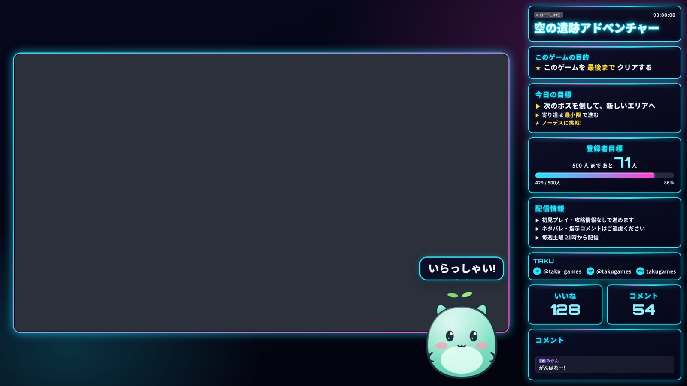
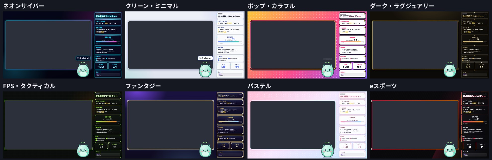
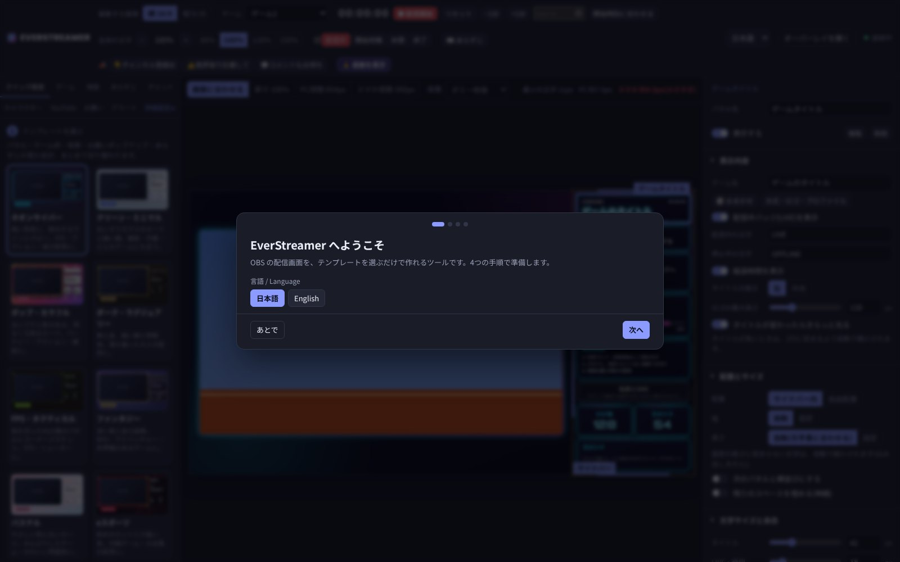
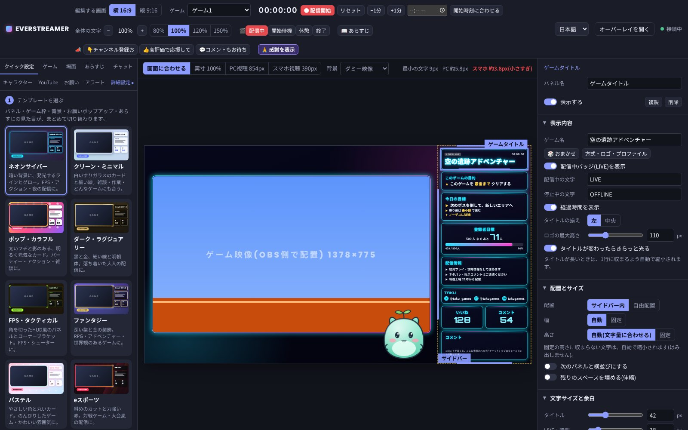
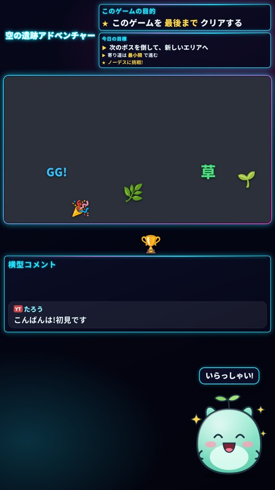
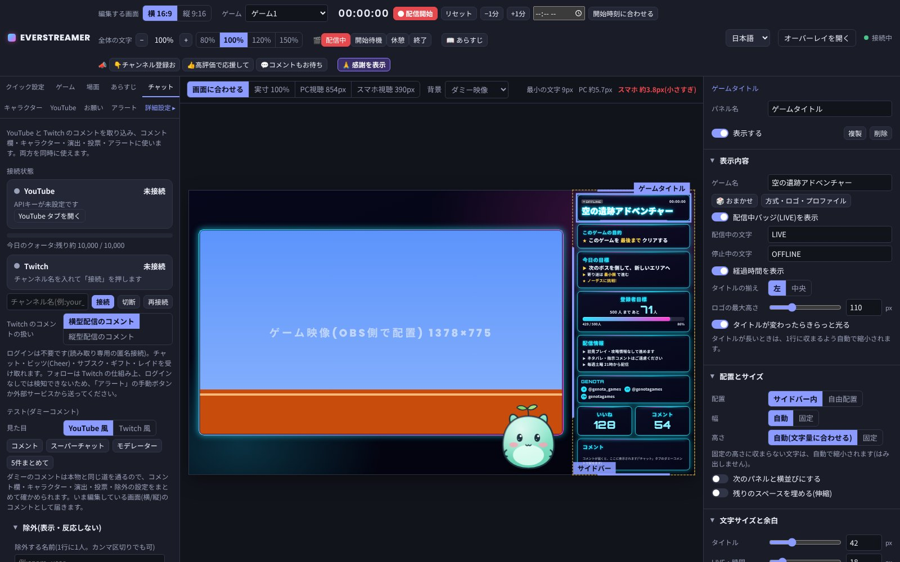
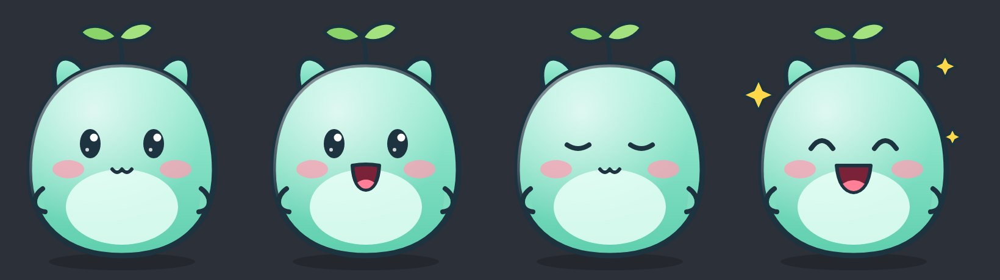
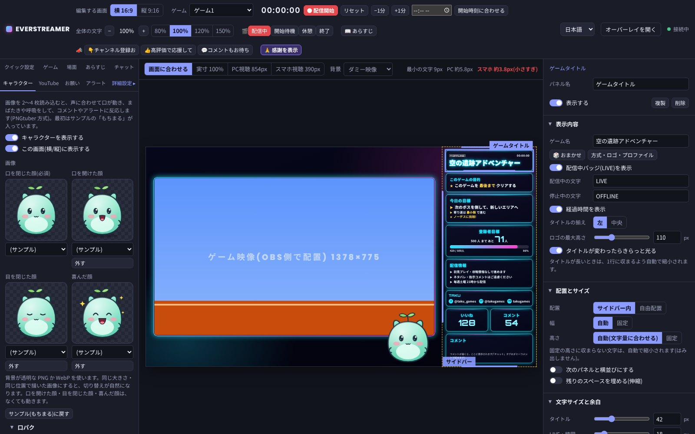
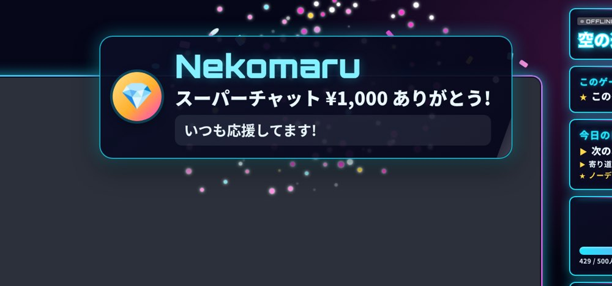
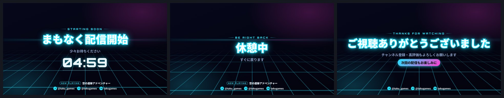

# EverStreamer

ゲーム配信者向けの、テンプレート式 OBS オーバーレイです。テンプレートを選んで、名前と色を入れるだけで、配信画面ができあがります。YouTube と Twitch のコメント、声に合わせて動くキャラクター、スーパーチャットなどのアラートにも対応しています。

[English](README.md) | **日本語**

- テンプレート 8 種類。メインカラーを変えると、全体の色がそろって変わります
- 横型配信(1920×1080)と縦型配信・ショート(1080×1920)の両方に対応
- YouTube(公式API)と Twitch のチャットを、同時に取り込めます
- 画像 2〜4 枚で動くキャラクター(PNGtuber 方式)。サンプルのマスコット付き
- スーパーチャット・メンバー・レイドなどのアラート、開始待機・休憩・終了の画面
- 自分の PC の中だけで動きます(外部に公開されるサーバーではありません)
- 管理画面は日本語と英語に対応しています

---

## もくじ

1. [テンプレート](#テンプレート)
2. [はじめかた](#はじめかた)
3. [OBS に登録する](#obs-に登録する)
4. [YouTube をつなぐ](#youtube-をつなぐ)
5. [Twitch をつなぐ](#twitch-をつなぐ)
6. [主な機能](#主な機能)
7. [データの保存場所と更新のしかた](#データの保存場所と更新のしかた)
8. [よくある問題](#よくある問題)
9. [ライセンス](#ライセンス)

---

## テンプレート

| テンプレート | 雰囲気 |
|---|---|
| ネオンサイバー | 暗い背景に発光するライン。FPS・アクション・夜の配信に |
| クリーン・ミニマル | 白いすりガラスのカード。雑談・作業・どんなゲームにも |
| ポップ・カラフル | 太いフチと影のある、明るく元気なカード |
| ダーク・ラグジュアリー | 黒と金、細い線と明朝体 |
| FPS・タクティカル | 角を切った HUD 風のパネル |
| ファンタジー | 深い紫と金の装飾。RPG・アドベンチャーに |
| パステル | やさしい色と丸いカード |
| eスポーツ | 斜めのカットと力強い赤 |

テンプレートを変えると、パネル・ゲーム枠・背景・タイトル文字・アラート・開始待機などの画面が、まとめて切り替わります。テンプレートは JSON と CSS で追加できます([CONTRIBUTING.md](CONTRIBUTING.md))。

---

## はじめかた

### 1. Node.js を入れる(最初の 1 回だけ)

[https://nodejs.org/](https://nodejs.org/) を開き、「LTS」と書かれたほうをダウンロードしてインストールします。設定はすべて初期のままで大丈夫です。バージョン 18 以上が必要です。

### 2. ダウンロードする

GitHub の [Releases](../../releases) から最新の `everstreamer-vX.X.X.zip` をダウンロードして、好きな場所に展開します(デスクトップやドキュメントなど)。

> git を使う場合:`git clone` してもかまいません。

### 3. 起動する

| OS | 起動のしかた |
|---|---|
| Windows | `start.bat` をダブルクリック |
| macOS | `start.command` をダブルクリック(初回は右クリック →「開く」) |
| Linux | ターミナルで `./start.sh` |

初回だけ、必要な部品のインストールに 1〜2 分かかります(インターネット接続が必要です)。起動すると、ブラウザで管理画面(`http://localhost:3000/admin`)が開きます。

起動したウィンドウは、配信中は閉じないでください。終了するときは、そのウィンドウで `Ctrl + C` を押すか、ウィンドウを閉じます。

> 手動で起動する場合:フォルダでターミナルを開き、`npm install` → `npm start`。

### 4. 初回の案内に沿って設定する

言語 → テンプレート → 名前とメインカラー → OBS への登録、の 4 つの手順です。あとから「クイック設定」タブでいつでも変えられます。

---

## OBS に登録する

1. OBS の「ソース」の `+` →「ブラウザ」を追加します
2. URL に `http://localhost:3000/overlay` を入れ、幅 `1920`・高さ `1080` にします
3. このブラウザソースを、ゲーム映像(ゲームキャプチャ・映像キャプチャデバイス)より **上** に置きます
4. ゲーム映像の位置と大きさを、管理画面の「クイック設定」→「OBS に登録する」に表示される数値に合わせると、枠にぴったり収まります

縦型配信(OBS の縦型キャンバスや、縦型用のプラグイン)では、もう 1 つブラウザソースを追加し、URL を `http://localhost:3000/overlay-vertical`、幅 `1080`・高さ `1920` にします。

- **効果音を配信に乗せるには**:ブラウザソースのプロパティで「OBS で音声を制御する」をオンにします
- 管理画面を閉じても、配信画面はそのまま表示されます(キャラクターの口パクを「管理画面のマイク」にしている場合は、管理画面を開いたままにしてください)

---

## YouTube をつなぐ

YouTube のコメント・高評価・視聴者数・登録者数は、YouTube の公式API(YouTube Data API v3)で取得します。APIキーが必要です(無料)。

### APIキーの取り方

1. [Google Cloud Console](https://console.cloud.google.com/) を開き、Google アカウントでログインします
2. 画面上部の「プロジェクトを選択」→「新しいプロジェクト」で、好きな名前のプロジェクトを作ります
3. 「APIとサービス」→「ライブラリ」で **YouTube Data API v3** を検索し、「有効にする」を押します
4. 「APIとサービス」→「認証情報」→「認証情報を作成」→「APIキー」を押します(`AIza` で始まるキーができます)
5. (おすすめ)キーの「編集」→「APIの制限」で「キーを制限」を選び、YouTube Data API v3 だけにチェックして保存します
6. 管理画面の「YouTube」タブにキーを貼り付けて「保存」を押します

同じ手順は、管理画面の YouTube タブにも表示されます。料金はかからず、クレジットカードの登録もいりません。

### 配信ごとの操作

1. 「YouTube」タブに、配信ページの URL(横型・縦型)を貼り付けます
2. 「取得を開始」を押します

- 1 日の無料枠(10,000 ユニット)を使い切らないよう、取得の間隔は自動で決まります。今日の残りの目安はバーで表示され、80% を超えると黄色、95% を超えると赤で知らせて、間隔を延ばします
- APIキーは、この PC の `data/youtube-key.json` にだけ保存されます。画面には末尾 4 文字しか表示されず、エラー文やログにも出ません

---

## Twitch をつなぐ

「チャット」タブにチャンネル名を入れて「接続」を押すだけです。ログインは不要です(読み取り専用)。

- チャット・ビッツ(Cheer)・サブスク・ギフト・レイドを受け取ります
- 接続が切れても、自動でつなぎ直します
- Twitch のコメントを、横型・縦型どちらの配信のコメントとして扱うかを選べます

---

## 主な機能

### コメント欄

名前・バッジ(配信者・モデレーター・メンバー・VIP)・Twitch のエモート・スーパーチャットの強調を、テンプレートの色で表示します。表示する件数、消えるまでの秒数、見た目(吹き出し/1行ずつ)を選べます。特定の名前・よくある Bot・「!」で始まるコマンドは除外できます。「チャット」タブのダミーコメントで、YouTube や Twitch につながなくても試せます。

### キャラクター(PNGtuber 方式)

画像を 2〜4 枚(口を閉じた顔・口を開けた顔・目を閉じた顔・喜んだ顔)読み込むと、声に合わせて口が動き、まばたきや呼吸をして、コメントやアラートに反応します。透過 PNG / WebP に対応し、サンプルのマスコット「もちまる」が入っています。

- **口パク**:管理画面のマイク(おすすめ。OBS の設定不要)/ OBS のマイク / コメントが来たとき / 押している間だけ
- **反応**:コメントで跳ねる、「草」「gg」などの言葉で喜んで吹き出しを出す、アラートで大きく喜ぶ(言葉は自由に設定できます)
- 位置と大きさは横型・縦型で別々に決められ、プレビュー上でドラッグして動かせます

### アラート

| | YouTube | Twitch |
|---|---|---|
| スーパーチャット / ビッツ | 自動 | 自動 |
| メンバー / サブスク | 自動 | 自動 |
| ギフト | 自動 | 自動 |
| レイド | 手動 | 自動 |
| フォロー | — | 手動・外部ツール |
| チャンネル登録 | 手動・外部ツール(登録者数の増加は「お祝い」で自動) | — |

- YouTube の公式APIでは「誰がチャンネル登録したか」が分からないため、名前つきの自動アラートは出せません
- Twitch のフォローはログイン(OAuth)が必要な仕組みのため、このツールでは検知しません
- どちらも、管理画面の手動ボタンか、アラートタブに表示される呼び出しURL(`/api/alert?token=…&kind=follow&name=…`)を使って、Stream Deck・Streamer.bot などの外部ツールから送れます

### 開始待機・休憩・終了の画面

「場面」タブ、上部バーのボタン、`Alt + 1〜4` で切り替えます。開始待機のカウントダウン、背景の動き、自分の画像・動画の背景に対応しています。

### そのほか

- **名前と SNS**:X・YouTube・Twitch・Discord・TikTok・Instagram の ID を表示
- **SNSアカウントパネル**:X・YouTube・Twitch・Instagram・TikTok・Bluesky・Threads・Discord などを複数登録して、縦・横・1つずつ切り替えで表示
- **大きな文字パネル**:好きな場所に置ける見出し文字。ネオン・メタリック・ポップ・サムネ風・写真の質感など 111 種類のデザイン、文字ごとの大きさと色、縁取り・光・影を調整でき、自分の見た目を「マイデザイン」に保存できます
- **フォントタブ**:PC に入っているフォントを使ったり、持っているフォントファイル(TTF / OTF / WOFF / WOFF2)を取り込めます。すべてのフォント選択欄に出ます
- **ゲームごとの画面設定**:ゲームタブで「ゲームごとに画面の設定を分ける」をオンにすると、ゲームプロファイルごとにパネル・レイアウト・背景・枠を覚えます
- **見出しを枠線の上に重ねる**:すべてのパネルの見出しを、ウィンドウのタイトルのように枠線の上に表示
- **ゲーム映像の場所**:プレビューの上でドラッグして場所と大きさを決められます。YouTube でチャット欄やボタンが重なる場所の目安も表示できます
- **横型・縦型の出力切り替え**:お祝い・感謝メッセージ・演出・コメント連動のパネルを、どちらの画面に出すか選べます
- **お願いポップアップ**:「チャンネル登録お願いします」などを、ボタン 1 つで画面に表示
- **あらすじ**:配信の前に、ゲームのあらすじを演出つきで表示
- **ゲームプロファイル**:ゲームごとにタイトル・ロゴ・背景・目標を保存して切り替え
- **投票・アイデア募集・カウンター**:コメントで投票やアイデア募集
- **お祝い・感謝**:登録者の目標達成のお祝い、配信終わりの感謝メッセージ
- **Stream Deck などから操作**:場面・お願いポップアップ・感謝・アラート・カウンターに、呼び出しURLがあります(この PC の中からだけ使えます)

各機能の細かい説明は [docs/FEATURES.ja.md](docs/FEATURES.ja.md) にあります。管理画面の「詳細設定 ▸」を押すと、パネル・レイアウト・背景・ゲーム枠・演出などの細かい調整ができます。

---

## データの保存場所と更新のしかた

設定・APIキー・アップロードした画像は、すべてフォルダ内の `data/` に保存されます。

- **バックアップ**:`data` フォルダをコピーしておきます
- **更新**:新しいバージョンの zip を、いまのフォルダに上書きで展開します(`data` フォルダはそのまま残ります)。そのあと、いつもどおり起動します
- **別の PC に移す**:フォルダごと(`data` を含めて)コピーします
- フォントは初回に Google Fonts から取得して `data/fonts/` に保存します。2 回目からはインターネットがなくても表示されます

---

## よくある問題

「Node.js が見つかりません」と表示される

[https://nodejs.org/](https://nodejs.org/) から LTS 版をインストールしてください。インストール後は、パソコンを再起動するか、ウィンドウを開き直してから `start.bat` をもう一度開きます。

「ポート 3000 は、ほかのアプリが使っています」と表示される

すでに起動していないか確認してください(別のウィンドウで起動したままかもしれません)。別のポートで起動する場合は、Windows ならコマンドプロンプトで `set PORT=3001` のあとに `start.bat`、macOS / Linux なら `PORT=3001 ./start.sh` とします。OBS の URL の `3000` も同じ番号に変えてください。

OBS に何も表示されない

- 起動したウィンドウが開いたままか確認します
- URL が `http://localhost:3000/overlay` になっているか、幅と高さが 1920×1080(縦型は 1080×1920)か確認します
- ブラウザソースのプロパティで「現在のページのキャッシュを更新」を押します

フォントが代わりの文字で表示される

フォントは、初回に表示するときに Google Fonts から取得します。インターネットにつながった状態で、管理画面と配信画面を一度開いてください。取得したフォントは保存されるので、次からはオフラインでも表示されます。

YouTube のコメントが来ない

- 「取得を開始」を押したか、配信が「ライブ中」か確認します(配信前・配信終了の動画ではコメントは届きません)
- YouTube タブの「ライブチャットの件数を数える」がオンか確認します
- エラーが表示されている場合:「YouTube Data API v3 が有効になっていません」→ 手順 3 を確認、「クォータを使い切りました」→ 太平洋時間の 0 時(日本時間の 16 時か 17 時)に戻ります
- 「チャット」タブの接続状態にも、理由が表示されます

Twitch に接続できない

チャンネル名(URL の `twitch.tv/` のあとの部分)が合っているか確認します。ファイアウォールやセキュリティソフトが通信を止めていないかも確認してください。

キャラクターの口が動かない

- 「管理画面のマイク」の場合:「マイクを使う」を押し、ブラウザでマイクを許可します。声のバーが黒い線を超えると口が開きます
- 「OBS のマイク」の場合:OBS を起動オプション(`--enable-media-stream --use-fake-ui-for-media-stream`)付きで起動する必要があります。うまくいかないときは「管理画面のマイク」に切り替えてください

効果音が配信に乗らない

OBS のブラウザソースのプロパティで「OBS で音声を制御する」をオンにし、OBS の音声ミキサーに出てくるブラウザソースの音量を確認します。

macOS で「開発元を確認できない」と表示される

`start.command` を右クリック(または control + クリック)→「開く」を選びます。2 回目からはダブルクリックで開けます。

---

## ライセンス

[MIT License](LICENSE)。フォント・依存パッケージなどのライセンスは [NOTICE.md](NOTICE.md) にまとめています。

テンプレートの追加や不具合の報告は、[CONTRIBUTING.md](CONTRIBUTING.md) と [Issues](../../issues) をご覧ください。

YouTube は Google LLC の、Twitch は Twitch Interactive, Inc. の商標です。このツールはそれらの会社とは関係ありません。
