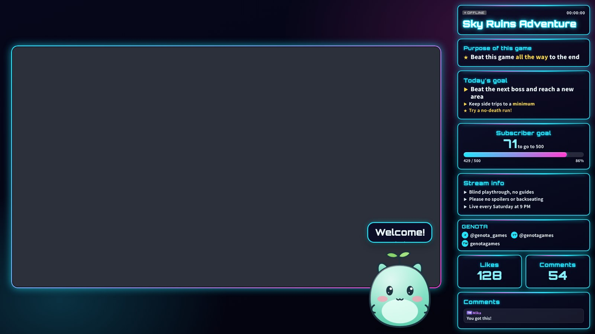
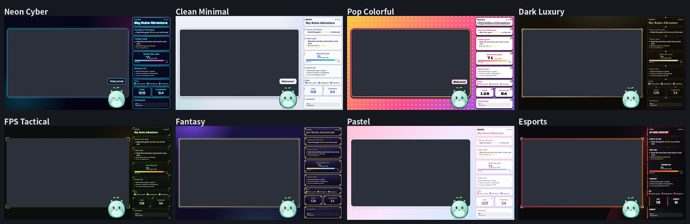
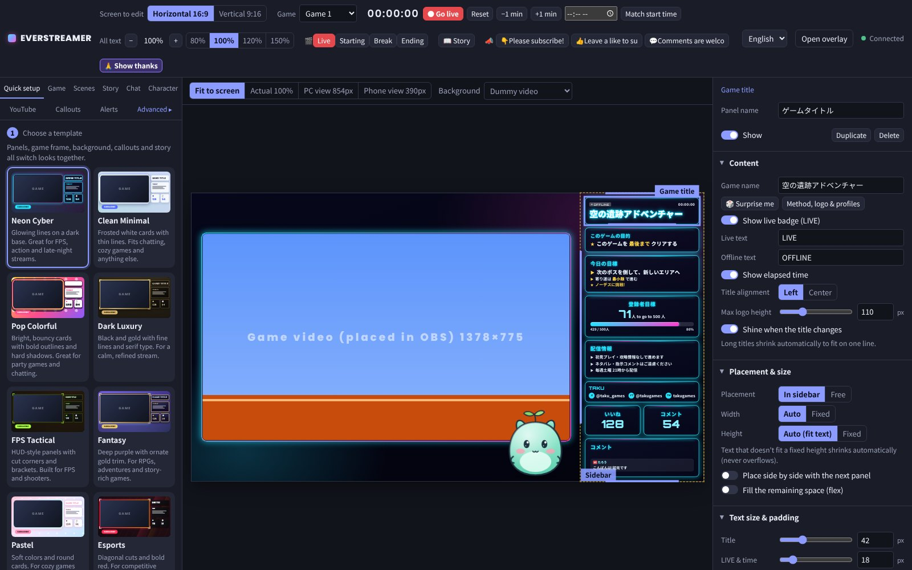
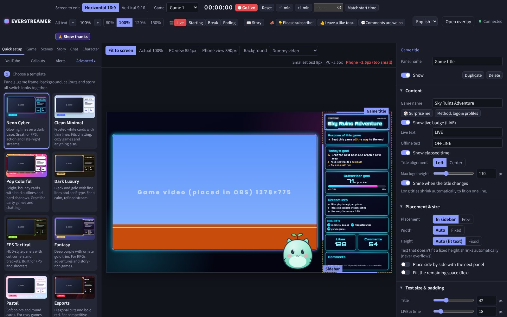
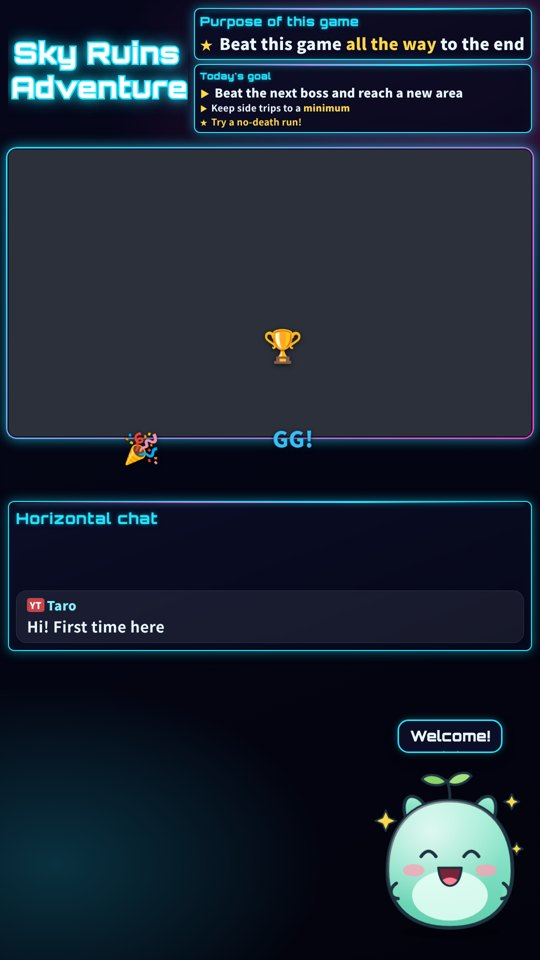
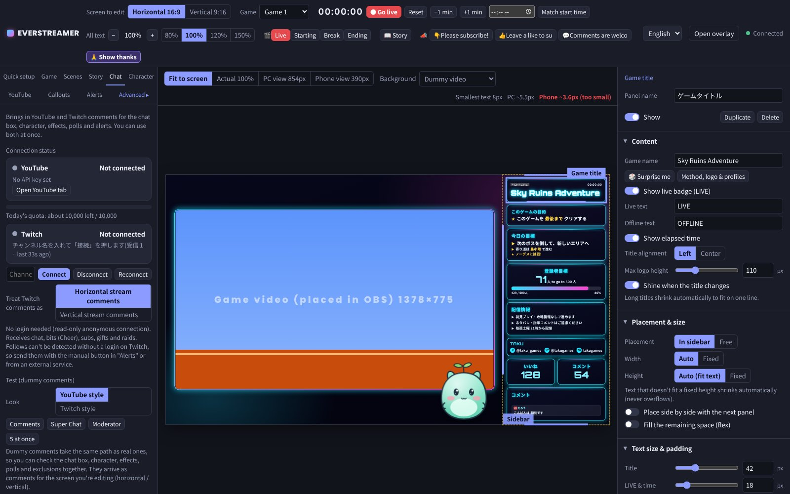
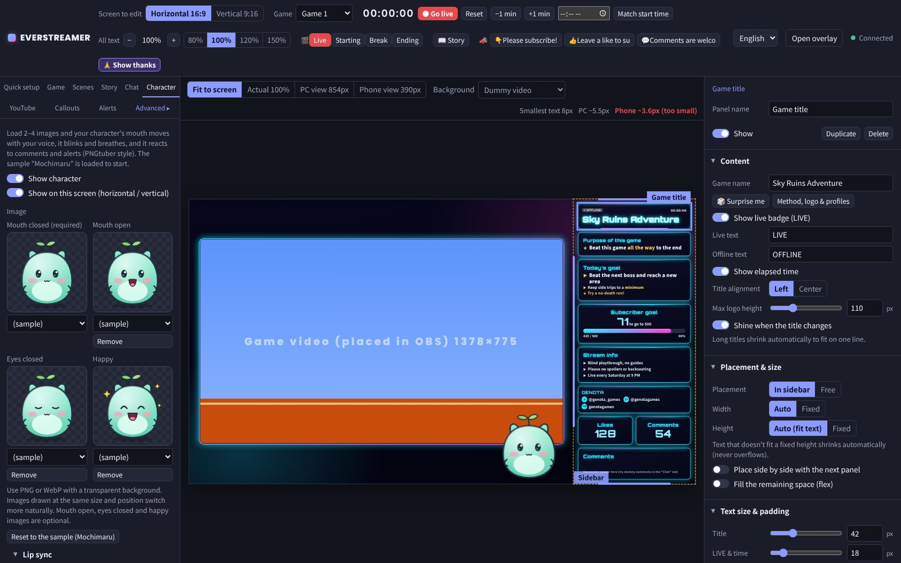
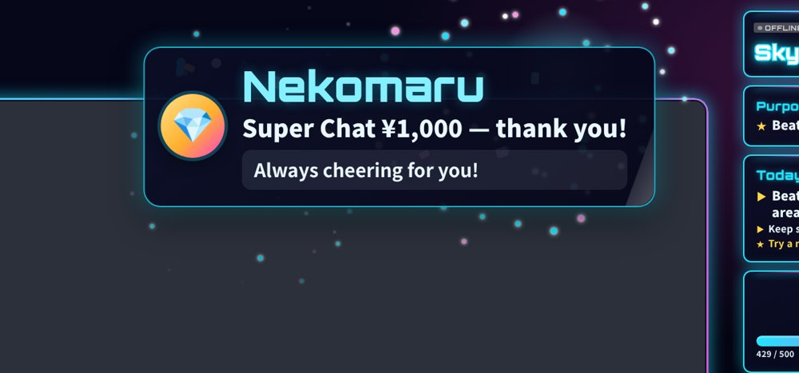
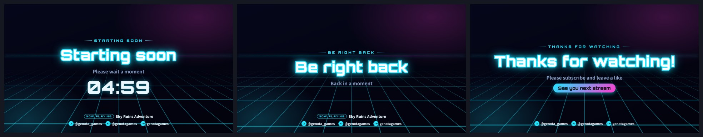

# EverStreamer

A template-based OBS overlay for game streamers. Pick a template, enter your name and a main color, and your stream layout is ready. It also brings in YouTube and Twitch chat, a character that moves with your voice, and alerts for Super Chats, subs and raids.

**English** | [日本語](README.ja.md)

- 8 templates. Change the main color and the whole layout follows
- Horizontal streams (1920×1080) and vertical streams / Shorts (1080×1920)
- YouTube (official API) and Twitch chat at the same time
- A PNGtuber-style character made from 2–4 images, with a sample mascot included
- Alerts for Super Chats, members, raids and more, plus Starting / Break / Ending screens
- Runs only on your own PC (it is not a server exposed to the internet)
- The admin page is available in English and Japanese

---

## Contents

1. [Templates](#templates)
2. [Getting started](#getting-started)
3. [Add it to OBS](#add-it-to-obs)
4. [Connect YouTube](#connect-youtube)
5. [Connect Twitch](#connect-twitch)
6. [Features](#features)
7. [Where your data lives / updating](#where-your-data-lives--updating)
8. [Troubleshooting](#troubleshooting)
9. [License](#license)

---

## Templates

| Template | Look |
|---|---|
| Neon Cyber | Glowing lines on a dark base. FPS, action, late-night streams |
| Clean Minimal | Frosted white cards. Chatting, cozy games, anything |
| Pop Colorful | Bright cards with bold outlines and hard shadows |
| Dark Luxury | Black and gold, fine lines and serif type |
| FPS Tactical | HUD-style panels with cut corners |
| Fantasy | Deep purple with ornate gold trim. RPGs and adventures |
| Pastel | Soft colors and round cards |
| Esports | Diagonal cuts and bold red |

Switching templates changes the panels, game frame, background, title text, alerts and the Starting / Break / Ending screens together. You can add your own template with a JSON and a CSS file — see [CONTRIBUTING.md](CONTRIBUTING.md).

---

## Getting started

### 1. Install Node.js (once)

Open [https://nodejs.org/](https://nodejs.org/), download the **LTS** version and install it with the default options. Version 18 or newer is required.

### 2. Download

Download the latest `everstreamer-vX.X.X.zip` from [Releases](../../releases) and extract it anywhere (e.g. your Desktop or Documents).

> You can also `git clone` the repository.

### 3. Start

| OS | How to start |
|---|---|
| Windows | Double-click `start.bat` |
| macOS | Double-click `start.command` (the first time: right-click → Open) |
| Linux | Run `./start.sh` in a terminal |

The first start installs dependencies, which takes 1–2 minutes and needs an internet connection. When it's ready, the admin page (`http://localhost:3000/admin`) opens in your browser.

Keep that window open while streaming. To quit, press `Ctrl + C` in it or close it.

> Manual start: open a terminal in the folder and run `npm install`, then `npm start`.

### 4. Follow the welcome guide

Language → template → name and main color → adding it to OBS. You can change everything later in the **Quick setup** tab.

---

## Add it to OBS

1. In OBS, click `+` under **Sources** and add a **Browser** source
2. Set the URL to `http://localhost:3000/overlay`, width `1920`, height `1080`
3. Place this browser source **above** your game video (Game Capture or Video Capture Device)
4. Set your game video's position and size to the values shown under **Quick setup → Add to OBS** so it fits the frame exactly

For vertical streams (OBS vertical canvas or a vertical plugin), add another browser source with the URL `http://localhost:3000/overlay-vertical`, width `1080`, height `1920`.

- **To include sound effects in your stream**, turn on **Control audio via OBS** in the browser source properties
- Closing the admin page does not affect the overlay (if your character's lip sync uses the **admin page microphone**, keep the admin page open)

---

## Connect YouTube

Comments, likes, viewers and subscriber counts come from YouTube's official API (YouTube Data API v3). You need a free API key.

### Getting an API key

1. Open [Google Cloud Console](https://console.cloud.google.com/) and sign in with your Google account
2. Click **Select a project** at the top → **New project**, and create one with any name
3. Go to **APIs & Services → Library**, search for **YouTube Data API v3** and click **Enable**
4. Go to **APIs & Services → Credentials → Create credentials → API key** (a key starting with `AIza` is created)
5. (Recommended) Click **Edit** on the key → under **API restrictions** choose **Restrict key**, check only YouTube Data API v3 and save
6. Paste the key into the **YouTube** tab of the admin page and click **Save**

The same steps are shown in the YouTube tab. It's free and no credit card is needed.

### For each stream

1. Paste your stream page URLs (horizontal and/or vertical) into the **YouTube** tab
2. Click **Start fetching**

- Fetch intervals are chosen automatically so you stay within the free daily quota (10,000 units). Today's remaining quota is shown as a bar; it turns yellow above 80% and red above 95%, and the intervals are extended
- The API key is stored only in `data/youtube-key.json` on your PC. Only the last 4 characters are ever shown on screen, and it never appears in error messages or logs

---

## Connect Twitch

Enter your channel name in the **Chat** tab and click **Connect**. No login is needed (read-only).

- Receives chat, bits (Cheer), subs, gifts and raids
- Reconnects automatically if the connection drops
- Choose whether Twitch comments count as horizontal-stream or vertical-stream comments

---

## Features

### Chat box

Shows names, badges (streamer, moderator, member, VIP), Twitch emotes and highlighted Super Chats in your template's colors. Choose how many comments to show, how long they stay, and the style (bubbles or one line each). You can exclude specific names, common bots and `!` commands. Use the dummy comments in the **Chat** tab to test without connecting YouTube or Twitch.

### Character (PNGtuber style)

Load 2–4 images (mouth closed, mouth open, eyes closed, happy) and your character's mouth moves with your voice; it blinks, breathes and reacts to comments and alerts. Transparent PNG / WebP are supported, and the sample mascot "Mochimaru" is included.

- **Lip sync**: admin page microphone (recommended, no OBS setup) / OBS microphone / when comments arrive / push-to-talk button
- **Reactions**: hops on comments, looks happy and shows a speech bubble for words like "lol" or "gg", celebrates on alerts (words are customizable)
- Position and size are set separately for horizontal and vertical; drag the character in the preview to move it

### Alerts

| | YouTube | Twitch |
|---|---|---|
| Super Chat / Bits | Auto | Auto |
| Members / Subs | Auto | Auto |
| Gifts | Auto | Auto |
| Raid | Manual | Auto |
| Follow | — | Manual / external tools |
| Channel subscription | Manual / external tools (count increases are detected by "Celebrate") | — |

- YouTube's official API doesn't tell you *who* subscribed, so named automatic subscription alerts aren't possible
- Twitch follows require a login (OAuth), so this tool doesn't detect them
- For both, use the manual buttons in the admin page, or the trigger URL shown in the Alerts tab (`/api/alert?token=…&kind=follow&name=…`) from external tools such as Stream Deck or Streamer.bot

### Starting / Break / Ending screens

Switch with the **Scenes** tab, the top-bar buttons, or `Alt + 1–4`. Includes a countdown for Starting, animated backgrounds, and your own image or video as a background.

### And more

- **Name & SNS**: show your X, YouTube, Twitch, Discord, TikTok and Instagram IDs
- **Social accounts panel**: list several accounts (X, YouTube, Twitch, Instagram, TikTok, Bluesky, Threads, Discord and more) stacked, side by side, or rotating one by one
- **Large text panel**: free-placement headline text with 111 ready-made designs (neon, metallic, pop, thumbnail style, photo textures…), per-character sizes and colors, outlines, glow and shadows; save your own looks to "My designs"
- **Font tab**: use fonts installed on your PC, or import your own font files (TTF / OTF / WOFF / WOFF2); they appear in every font picker
- **Per-game screen settings**: turn on "keep separate screen settings per game" in the Game tab and each game profile remembers its own panels, layout, background and frame
- **Panel headings on the border**: put every panel's heading on top of its border like a window title
- **Game video area**: drag and resize the game video area right in the preview, and show a guide for where YouTube's chat and buttons will overlap
- **Horizontal / vertical output toggle**: choose which screens celebrations, thank-you messages, effects and chat-linked panels appear on
- **Callouts**: show "Please subscribe!" and similar messages with one button
- **Story**: show your game's story so far with effects before the stream
- **Game profiles**: save title, logo, background and goals per game and switch between them
- **Polls, idea collection, counters** driven by chat
- **Celebrate & Thanks**: celebrate subscriber goals, show thank-you messages at the end
- **Control from Stream Deck etc.**: scenes, callouts, thanks, alerts and counters have trigger URLs (usable only from your PC)

Click **Advanced ▸** in the admin page for fine-tuning of panels, layout, background, game frame and effects.

---

## Add-on packs

Put an add-on pack folder into the `packs` folder and EverStreamer loads its templates, large-text designs, textures and characters automatically (even while running). Updating EverStreamer keeps the `packs` folder. See [packs/README.md](packs/README.md) for the folder layout if you want to make your own.

An optional paid pack (**EverStreamer Premium Pack Vol.1**: 6 more templates, 35 large-text designs, 10 textures and 2 characters) is sold separately on BOOTH. Everything in this repository stays free.

---

## Where your data lives / updating

Settings, the API key and uploaded images are all stored in the `data/` folder.

- **Backup**: copy the `data` folder
- **Update**: extract the new version's zip over your current folder (the `data` folder is kept), then start as usual
- **Move to another PC**: copy the whole folder, including `data`
- Fonts are downloaded from Google Fonts the first time and saved in `data/fonts/`, so they work offline afterwards

---

## Troubleshooting

"Node.js is not installed"

Install the LTS version from [https://nodejs.org/](https://nodejs.org/). Restart your PC (or reopen the window) and run `start.bat` again.

"Port 3000 is already in use"

Check that it isn't already running in another window. To use another port: on Windows, run `set PORT=3001` in Command Prompt and then `start.bat`; on macOS / Linux, run `PORT=3001 ./start.sh`. Change `3000` in your OBS URLs to the same number.

Nothing shows up in OBS

- Check that the window you started is still open
- Check the URL (`http://localhost:3000/overlay`) and the size (1920×1080, or 1080×1920 for vertical)
- Click **Refresh cache of current page** in the browser source properties

Fonts look wrong (fallback fonts)

Fonts are downloaded from Google Fonts the first time they're shown. Open the admin page and the overlay once while online. They are saved, so they work offline afterwards.

YouTube comments don't arrive

- Check that you clicked **Start fetching** and the stream is **live** (no comments arrive for upcoming or ended videos)
- Check that **Count live chat messages** is on in the YouTube tab
- If an error is shown: "YouTube Data API v3 is not enabled" → see step 3; "quota is used up" → it resets at midnight Pacific Time
- The **Chat** tab's connection status also shows the reason

Twitch won't connect

Check the channel name (the part after `twitch.tv/` in the URL). Also check that a firewall or security software isn't blocking the connection.

The character's mouth doesn't move

- **Admin page microphone**: click **Use microphone** and allow the microphone in your browser. The mouth opens when the voice bar passes the black line
- **OBS microphone**: OBS must be started with `--enable-media-stream --use-fake-ui-for-media-stream`. If it doesn't work, switch to the admin page microphone

Sound effects aren't in the stream

Turn on **Control audio via OBS** in the browser source properties, and check the browser source's volume in the OBS audio mixer.

macOS says the developer cannot be verified

Right-click (or Control-click) `start.command` → **Open**. After the first time, a double-click works.

---

## License

[MIT License](LICENSE). Licenses for fonts and dependencies are listed in [NOTICE.md](NOTICE.md).

To add a template or report a bug, see [CONTRIBUTING.md](CONTRIBUTING.md) and [Issues](../../issues).

YouTube is a trademark of Google LLC and Twitch is a trademark of Twitch Interactive, Inc. This project is not affiliated with either company.
